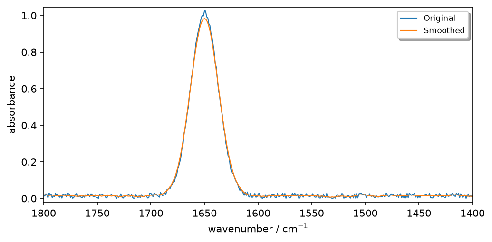

<h1 align ="center">

<br>
SpectroChemPy
</h1>

[](https://github.com/spectrochempy/spectrochempy/actions)
[](https://codecov.io/gh/spectrochempy/spectrochempy)

[](https://badge.fury.io/py/spectrochempy)
[](https://www.spectrochempy.fr/)
[](https://doi.org/10.5281/zenodo.3823841)


## What is SpectroChemPy?

SpectroChemPy (SCPy) is a framework for processing, analyzing, and modeling
spectroscopic data for chemistry with Python. It is cross-platform (Linux,
Windows, macOS) and combines a lightweight scientific core with optional
plugins for domain-specific workflows.

Its central object, `NDDataset`, provides numerical data together with
coordinates, units, masks, labels, history, and metadata, making it easier
to build reproducible spectroscopy workflows in Python.

## Quick Start

Create and smooth a synthetic spectrum using only the core package; no plugin
or data download is needed. Run this in a Python script or Jupyter notebook:

```python
import spectrochempy as scp

wavenumbers = scp.Coord.linspace(1800, 1400, 401, units="cm^-1", title="wavenumber")
profile = scp.gaussian(wavenumbers, pos=1650, width=30, normalized=False)
spectrum = scp.NDDataset(profile, coordset=[wavenumbers], title="absorbance")
spectrum += 0.03 * scp.random(spectrum.shape, seed=42)
smoothed = spectrum.smooth(size=11)

_ = scp.plot_multiple(
    [spectrum, smoothed], method="pen", labels=["Original", "Smoothed"],
    legend="upper right", ylabel="absorbance", figsize=(7, 3.5),
)
scp.show()
```



For measured data, start with `dataset = scp.read("path/to/spectrum.spa")`.
See the [reader catalog](https://www.spectrochempy.fr/latest/userguide/importexport/readers.html)
for supported formats and required plugins, and the
[quickstart tutorial](https://www.spectrochempy.fr/latest/gettingstarted/quickstart.html)
for a complete workflow.

## Key Features

* **Core Data Structure**: `NDDataset` with coordinates, units, masks, labels,
  history, and metadata
* **Project Management**: Organize and manipulate multiple datasets within a
  `Project`
* **Data Processing**:
  * Unit-aware mathematical operations
  * Baseline correction, automatic subtraction, smoothing, denoising, despiking
  * Coordinate alignment, interpolation, integration, peak finding, FFT workflows
  * Core processing with plugin-specific extensions where appropriate
* **Analysis Tools**:
  * SVD, PCA, MCR-ALS, EFA, PLS, fitting, and related result objects
* **I/O and Interoperability**:
  * Import from major spectroscopy and scientific data formats
  * Export to lightweight interchange formats such as CSV, JCAMP-DX, and
    minimal MATLAB `.mat` exchange files
  * Portable `NDDataset ↔ xarray.Dataset ↔ NetCDF` round-trips for the
    maintained portable subset (requires optional `xarray` and a NetCDF backend)
  * Safe native `.scp` / `.pscp` persistence by default, with explicit legacy
    opt-in only for historical trusted archives
* **Plugin System**:
  * Automatic discovery of optional plugins
  * Namespaced APIs: `scp.nmr.read_topspin(...)`, `scp.iris.IRIS()`
  * Dataset accessors for plugin-bound operations

The history records participating operations on a dataset. It is inspectable,
but it is not a complete provenance record; reproducibility also requires the
originating script or notebook, inputs, environment, and parameters.

## Installation

SpectroChemPy requires **Python 3.11 or newer**.

The recommended way to install SpectroChemPy is with
[`uv`](https://docs.astral.sh/uv/getting-started/installation/). Once `uv` is installed:

```bash
uv venv scpy --python 3.13
# Linux / macOS:
source scpy/bin/activate
# Windows PowerShell:
# .\scpy\Scripts\Activate.ps1
uv pip install spectrochempy
```

Alternatively, with `mamba` / `conda`:

```bash
mamba install -c conda-forge -c spectrocat spectrochempy
```

Or with `pip`:

```bash
python -m pip install spectrochempy
```

See the [full installation guide](https://www.spectrochempy.fr/latest/gettingstarted/install/index.html) for platform-specific instructions, optional dependencies, and development setup.

## Official Plugins

Extend SpectroChemPy with official plugins (installed separately):

| Plugin | Install | What it provides |
|--------|---------|------------------|
| `spectrochempy-carroucell` | `uv pip install spectrochempy-carroucell` | Carroucell experiment reader |
| `spectrochempy-iris` | `uv pip install spectrochempy-iris` | Regularized inversion for adsorption and diffusion studies |
| `spectrochempy-nmr` | `uv pip install spectrochempy-nmr` | NMR readers (Bruker, Agilent/Varian, JEOL, SIMPSON) and processing |
| `spectrochempy-perkinelmer` | `uv pip install spectrochempy-perkinelmer` | PerkinElmer `.sp` IR file reader |
| `spectrochempy-tensor` | `uv pip install spectrochempy-tensor` | TensorLy-backed tensor decompositions, including CP/PARAFAC |

`python -m pip install` works as well if you are not using `uv`.
You can also install the core and selected plugins together using extras:

```bash
uv pip install "spectrochempy[nmr]"       # or [iris], [tensor]
uv pip install "spectrochempy[plugins]"   # all official plugins
```

For optional xarray/NetCDF interoperability, install `xarray` and a NetCDF
backend such as `netCDF4` in the same environment.

Plugins are also available via conda from the `spectrocat` channel:

```bash
mamba install -c conda-forge -c spectrocat spectrochempy-nmr
```

Plugins are discovered automatically once installed — no manual loading step required.

### Experimental plugins

`spectrochempy-cantera` is available as an **experimental** plugin. It is not
officially supported, not included in aggregate extras, and must be installed
manually:

```bash
python -m pip install spectrochempy-cantera
```

## Quick Links

* 📚 [Documentation](https://www.spectrochempy.fr)
* 🔌 [Plugins](https://www.spectrochempy.fr/latest/userguide/plugins/index.html)
* 🚀 [Installation Guide](https://www.spectrochempy.fr/latest/gettingstarted/install/index.html)
* 📓 [Example Notebooks](https://www.spectrochempy.fr/latest/gettingstarted/examples/index.html)
* 🐛 [Issue Tracker](https://github.com/spectrochempy/spectrochempy/issues)
* 📝 [How to Cite](https://www.spectrochempy.fr/latest/credits/citing.html)
* 💻 [Source Code](https://github.com/spectrochempy/spectrochempy)

## For contributors

If you want to contribute, start with:

* [`CONTRIBUTING.md`](CONTRIBUTING.md)
* the developer guide under [`docs/sources/devguide/`](docs/sources/devguide/)
* the [issue tracker](https://github.com/spectrochempy/spectrochempy/issues)

Maintainer release procedures live in [`maintainers/`](maintainers/).
Architecture, RFCs, and roadmap discussions are maintained in the
**SpectroChemPy Maintainer Repository**.

## License

[CeCILL-B FREE SOFTWARE LICENSE AGREEMENT](https://cecill.info/licences/Licence_CeCILL-B_V1-en.html)
