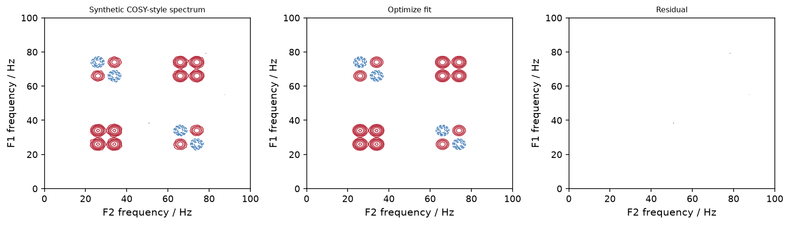

.. _fit-cosy-2d:

Fit a synthetic COSY-style 2D spectrum
============================================================

``Optimize(model=..., parameters=...)`` fits a callable on a complete
``NDDataset`` grid. This example uses two diagonal features and a symmetric
pair of signed cross peaks, with the same resonance frequencies, doublet
splitting and line width throughout the map.

Only SpectroChemPy is imported: line shapes use ``scp.gaussian``, noise uses
``scp.normal``, fitting uses ``scp.Optimize`` and plots use ``scp.multiplot``.
No input data, NMR plugin, pandas or explicit NumPy import is needed.
The array broadcasting inside the callback assembles full-grid responses
from the public one-dimensional profiles.

This is a **pedagogical first-order line-shape model**, not a simulation of
a COSY pulse sequence. It illustrates diagonal and antiphase cross-peak
patterns for two weakly coupled resonances. It omits coherence-transfer
amplitudes, relaxation and strong coupling. The fitted splitting is the
injected line separation in this synthetic model; fitting an experimental
coupling requires a validated forward model for that experiment.

Define the shared model
------------------------

Each doublet is a sum or difference of Gaussian lines separated by
``coupling``. ``width`` is their full width at half maximum (FWHM), in Hz.
The same frequency for resonance A occurs on F1 and F2, as does that of B.
Both cross peaks share one amplitude and both resonances share one splitting
and line width. The returned ``cross_pair`` is a sum of two outer products,
with positive and negative lobes.

.. literalinclude:: _scripts/fit_cosy_2d.py
   :language: python
   :start-at: import spectrochempy
   :end-before: f1 = scp.Coord

The callback receives a detached, zero-valued template with full-precision
coordinates and the effective observation mask, followed by numerical
parameters in their declared units. Returning named components with
``linear_amplitudes=True`` lets the solver estimate their nonnegative
coefficients internally. Component responses themselves keep their signs;
the cross peaks are never clipped or replaced by absolute values.

Generate and fit a small spectrum
---------------------------------

The injected values are 30 and 70 Hz for the resonance frequencies, 8 Hz
for the splitting, and 3 Hz for the line FWHM. Diagonal amplitudes are
1.0 and 0.8; the cross-pair amplitude is 0.35. Independent normal noise has
standard deviation 0.005 and a fixed seed.

The starting parameters differ from the injected values. Bounds keep the
resonances distinguishable and the width and splitting positive.

.. literalinclude:: _scripts/fit_cosy_2d.py
   :language: python
   :start-at: f1 = scp.Coord
   :end-before: print(f"Converged:

Inspect the fit and residual
----------------------------

Compare the returned parameters with the injected values and the residual
RMS with the known noise standard deviation. This checks recovery under the
chosen model; generation and fitting use the same line-shape assumptions,
so it does not validate the model for experimental spectra.

.. literalinclude:: _scripts/fit_cosy_2d.py
   :language: python
   :start-at: print(f"Converged:

All three panels use the same contour levels. Solid and dashed lines denote
positive and negative contours. Outputs preserve the input grid, units and
mask; nonfinite and masked observations are excluded consistently.

There are four nonlinear parameters and three projected amplitudes. Residual
degrees of freedom count all seven. The retained Jacobian has four columns
for the profiled nonlinear problem. A joint parameter/amplitude covariance
is unavailable, explicitly reported as ``profiled_amplitudes``.
``result.fitted_parameters`` contains the shared line-shape parameters and
``result.amplitudes`` the component coefficients.

Download :download:`the complete script <_scripts/fit_cosy_2d.py>`.

The same callable interface can fit a physical MQMAS response generated by
PULSAR. That response must include the sequence, calibration and processing
appropriate to the data, including any experimental apodization;
``Optimize`` does not infer those operations from the observation.
