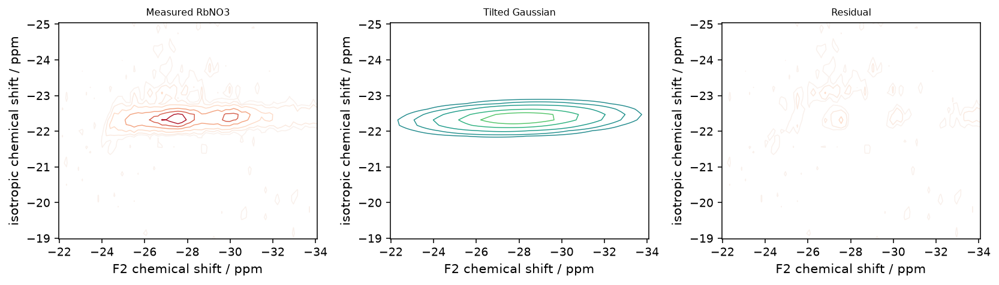

.. _fit-mqmas-2d:

Fit a full-grid 2D model: a RbNO₃ feature
============================================================

``Optimize(model=..., parameters=...)`` fits a callable evaluated on a whole
``NDDataset`` grid. This supports nonseparable models, where the F2 profile
changes with F1. A physical MQMAS response can be supplied through the same
interface, with starting values from an inversion.

This short example fits **one feature in a measured ⁸⁷Rb MQMAS spectrum**
with a tilted Gaussian. It estimates feature positions, widths and tilt;
it does not estimate quadrupolar coupling, asymmetry or chemical-shift
distributions. Those require a physical response including the experimental
sequence, referencing, acquisition window and apodization.

Input and optional plugin
-------------------------

Install ``spectrochempy-nmr`` separately for reading and MQMAS processing.
The example uses its public ``Experiment`` operations and requires a version
supporting ``select_coherence``, ``xf2``, ``xf2p`` and ``xfshear``.
Core fitting itself has no NMR dependency.

Use experiment ``RbNO3/206`` from
`the public data revision 34448ef
<https://github.com/spectrochempy/spectrochempy_data/tree/34448ef343f17a2ee57d2bc06661ac90e2d1ff48/testdata/nmrdata/bruker/tests/nmr/RbNO3/206>`_.
These acquisition and processing parameters and SER are CC BY 4.0,
attributed to Christian Fernandez, LCS; see the revision's
`provenance register
<https://github.com/spectrochempy/spectrochempy_data/blob/34448ef343f17a2ee57d2bc06661ac90e2d1ff48/testdata/nmrdata/PROVENANCE.md>`_.
Place the experiment under
``scp.preferences.datadir / "nmrdata/bruker/tests/nmr/RbNO3/206"``.
Retain ``acqus``, ``acqu2s``, ``acqu3s``, ``pdata/1/procs`` and
``pdata/1/proc2s`` alongside ``ser``. No pulse-program source is needed.
The NMR plugin's gallery-fixture fetcher also installs this public input.

Read, phase and shear
----------------------

The phase-cycle selection precedes the Fourier transforms. The initial
zero-order phase makes the strongest point in the first F2 trace real.
Inspect this phase before extending the example to other regions or data.
No additional apodization is applied here. The final fit uses the real RR
plane in a small, explicitly selected window, normalized by its peak.

.. literalinclude:: _scripts/fit_rbno3.py
   :language: python
   :start-at: from cmath
   :end-at: observed = observed / abs(observed).max()

Define and fit the model
------------------------

The callback receives a detached zero-valued template with the input grid
and observation mask. Numerical parameters use their declared units.
Here NumPy broadcasts the coupled F1/F2 expression; there is no separable
2D peak expression for this tilted response. ``width1`` and ``width2`` are
standard deviations, not FWHM values. ``tilt`` is dimensionless.

Returning a named response lets ``linear_amplitudes=True`` estimate a
positive amplitude internally at each nonlinear step. Bounds keep the widths
positive and restrict the feature position to the selected region.

.. literalinclude:: _scripts/fit_rbno3.py
   :language: python
   :start-at: def tilted_peak
   :end-before: print(f"Converged:

Inspect the residual
--------------------

The reference execution converged with a peak-normalized residual RMS of
about 4.24%. Structured residuals remain because this simple Gaussian does
not describe the quadrupolar line shape. A small residual alone would not
validate a physical interpretation either.

There are five nonlinear parameters and one projected amplitude. Residual
degrees of freedom count all six; the retained Jacobian has five profiled
columns. A joint parameter/amplitude covariance is unavailable, explicitly
reported as ``profiled_amplitudes``. Amplitudes of this phenomenological model
are not site populations. In this mode, ``fitted_parameters`` reports the
callback parameters and ``amplitudes`` the linear coefficients.

.. literalinclude:: _scripts/fit_rbno3.py
   :language: python
   :start-at: print(f"Converged:

All three panels use the same contour levels. Solid and dashed contours
show positive and negative intensities. Outputs retain the input grid,
units and mask. Nonfinite or masked observations are excluded consistently.

Download :download:`the complete script <_scripts/fit_rbno3.py>`.
For physical MQMAS fitting, replace ``tilted_peak`` with the calibrated
forward response; any experimental apodization must also be applied to that
response before fitting. ``Optimize`` does not infer it from the observation.
